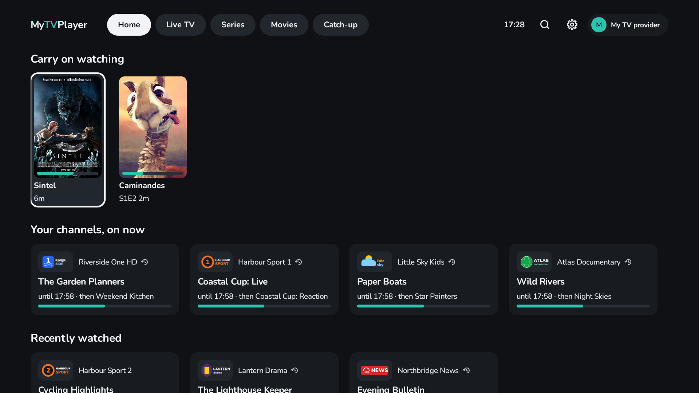
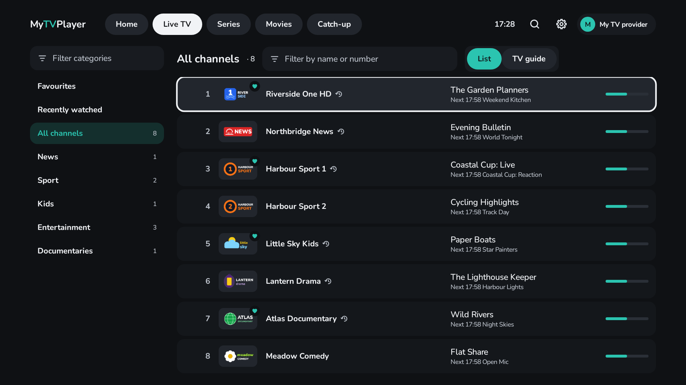
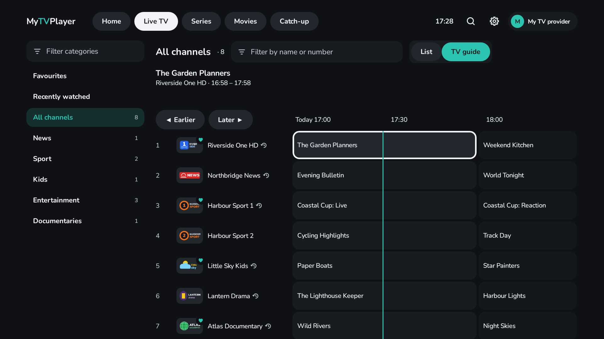
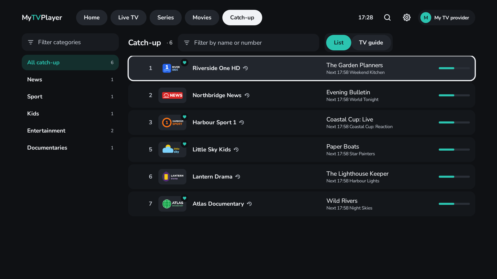
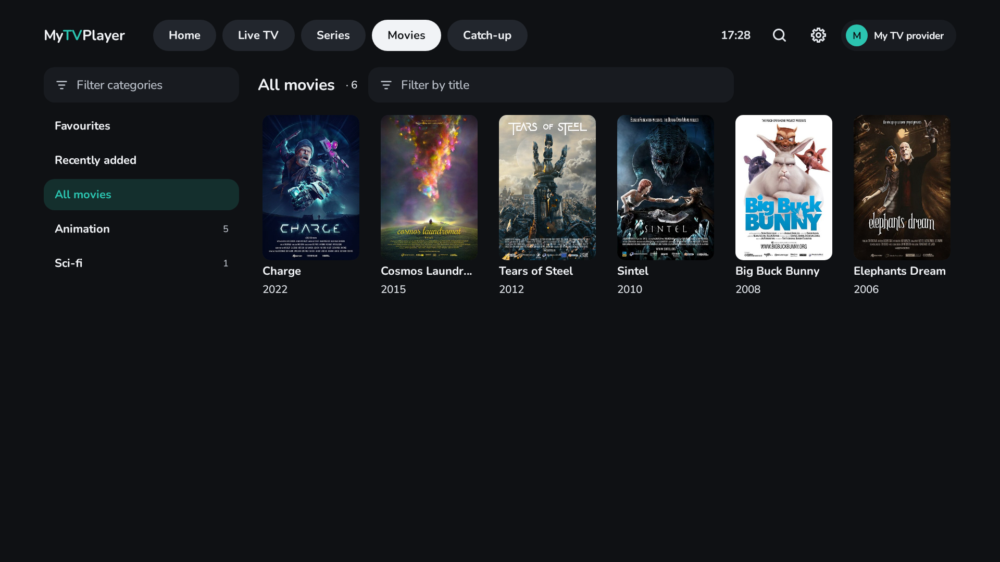
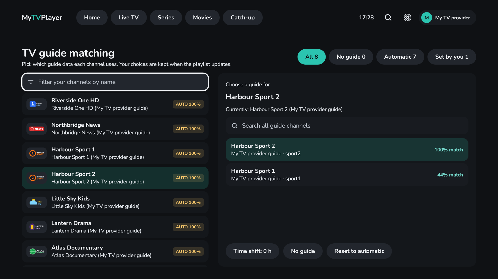
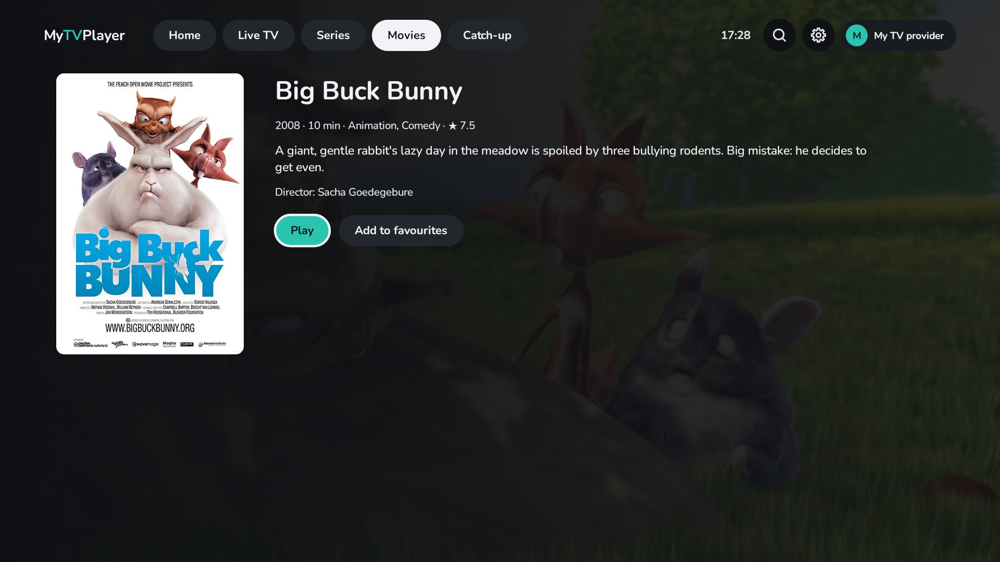
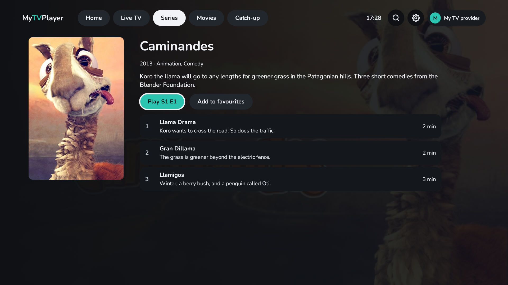

[](https://ko-fi.com/biskyt) [](https://github.com/sponsors/biskyt)

_This work is free, with no ads and no tracking and no data collection. If you find it useful, you can support its development by buying me a coffee with the links above._


# MyTVPlayer

A fast, free and open-source IPTV player for Android TV and Fire TV (Android 9 and later), that also works by touch
on phones and tablets in landscape. It's built to feel quick on low-powered TV boxes and sticks, and to make it easy
to find something to watch and press play.

- **Fast**, even on budget boxes, with channel lists of thousands.
- **Excellent TV guide matching**, with simple manual overrides when you want them.
- **Small**: an 8 MB download.
- **No ads, no tracking, and no account needed.** Every feature is free.
- **Your own provider or free channels**: add your IPTV provider's Xtream Codes login or M3U playlist, or start
  straight away with the built-in [free TV](https://github.com/biskyt/legalFreeIPTVplaylist): channels streamed
  free by their broadcasters, and public-domain or openly licensed films and series.
- **Movies, series and catch-up TV**, for providers that offer them.
- **Optional sync between TVs**: carry on a film or an episode on another TV, through your own Google Drive. It is
  off unless you turn it on. [How it works, and your privacy](#sync-between-tvs-optional).



| | |
|---|---|
|  |  |
|  |  |

<sub>Demo channels and logos are invented. Movies and series: the Blender Foundation's open movies, CC BY 3.0/4.0,
cropped ([credits, with each image's author and licence](app/src/test/resources/demo-art/CREDITS.md)).</sub>

## Features

### Live TV and the TV guide
- **Channel list** with logos and what's on now and next, or a **full TV guide grid**: switch between them with one
  press.
- **Categories grouped by country and language** (from names like `UK |` or `FR:`, or a playlist's `tvg-country` and
  `tvg-language`). Pick the ones you want, or select all or none in one go, and only those are downloaded, so even
  very large playlists stay quick. Hide any category you don't need.
- **Filter by name or number**, or type a channel number on the remote to jump straight to it.
- **Home** shows your favourite channels with what's on now, recently watched channels and what you're part-way
  through.
- **Search** everything at once: channels, what's on TV now and later, movies and series.
- The remote's **Guide** button opens the TV guide from anywhere.

### TV guide matching


- Channels are matched to their guide automatically, including tricky names: misspellings, "HD/FHD" tags, US call
  signs and state names.
- Add your provider's guide, free guides for 75 countries ([iptv-epg.org](https://iptv-epg.org)) or any XMLTV
  address.
- **Manual overrides**: for any channel, pick its guide from ranked suggestions or search every guide channel, and
  set a time shift. Your choices are kept when the playlist updates.
- **Match channels without a guide** finds guides for the channels that still have none.
- **Guide order**: put a playlist's guides in order with Move up and Move down. When two guides both have a channel,
  the guide higher in the list is used.

### Catch-up TV
- A **Catch-up** tab lists those channels by category; a small ⟲ mark shows them everywhere else too.
- Browse the last few days, day by day, or scroll back in the TV guide and pick a finished programme.
- **Start over** watches what's on now from its beginning.
- Works with Xtream Codes accounts, and with M3U playlists that declare catch-up on their channels (`catchup`,
  `catchup-days`, `catchup-source`). M3U catch-up is offered in hour-long slots.

### Movies and series
| | |
|---|---|
|  |  |

- From Xtream Codes accounts, or from an M3U playlist's own movies and series playlists (one playlist holding both is
  fine: episodes like "Show S01E02" go to Series, the rest to Movies).
- Browse by category with posters, filter by title, and see what's recently added.
- Details pages with plot, cast and running time (where the provider gives them), and every season and episode of a
  series.
- Movies and episodes **resume where you left off**, and **Continue watching** on Home takes you straight back, to
  the next episode once one ends.
- From a programme in the TV guide, **Find series** or **Find in Movies** to watch it on demand.

### Playback
- Now and next, and the controls, on OK. The channel's guide opens in a side panel without stopping the picture.
- Skip back and forward (10 s / 30 s by default), or hold ◀ ▶ to scrub along the play bar.
- **Audio passthrough** of Dolby, DTS and Atmos to your soundbar or TV, with a software fallback.
- **Subtitles**: forced subtitles in your TV's language by default, or always available, or off.
- A provider channel that won't start in MPEG-TS is tried in HLS, or the other way round, and the format that works is
  remembered for that provider.
- When something won't play, a clear message says why.

### And more
- **Several playlists**: add as many as you like and switch between them from the top bar. Settings shows when a
  provider's subscription expires.
- **A proxy for each playlist** (HTTP or SOCKS5, with an optional login): the playlist's login, lists, TV guide,
  streams and images (logos and posters) go through it, and the proxy looks up the provider's names. Check proxy shows
  the address that the provider then sees.
- **Backup and restore** of your playlists, choices, favourites, guide matching and progress, to a file you can
  copy to another TV.
- **Appearance**: preset accent colours and large text.
- **VPN check**: a badge in the top bar shows whether Android reports a VPN, and can also show your external IP address
  and its country (from ipinfo.io, off by default).
- **Proxy check**: a badge in the top bar and on the player shows whether the active playlist's proxy works, with the
  address that its provider sees, and warns when that address is your own (from ipinfo.io, off by default).
- **The TV's home screen** (off by default): Continue watching in the home screen's Play Next row, with posters, and
  your favourite channels as a row of their own. The app serves the pictures itself (through the playlist's proxy),
  and restricted titles and channels never go there. Android TV's own launcher and others that read the TV provider
  show them; Google TV's home screen shows no app rows.
- **Looks after its own storage**: only the guide for channels you use is kept, logos are capped and the database is
  kept compact.

## Sync between TVs (optional)

This is **off unless you turn it on**, in Settings › Sync between TVs. It keeps your place in films and episodes the
same on all your TVs: stop a film on one TV, and carry on from the same point on another. It also keeps your choices
the same on each TV: favourites, recently watched channels, hidden channels, the categories that you tick or
restrict, and your TV guide choices.

**How it works**
- On each TV, you sign in with the same Google account. The TV shows a code: enter it at google.com/device on your
  phone or computer, or scan the QR code.
- Each TV keeps a small file of what you watched in a folder called **MyTVPlayer** in **your own Google Drive**. The
  other TVs read it from there. You can see the folder in Drive.
- Sync includes your place in films and episodes, your favourite channels, films and series (in your order),
  recently watched channels, hidden channels, the categories that you tick in Settings › Categories, the categories
  that the parental controls restrict, the TV guides that you add, and the guide channel that you choose for a
  channel. It does not include your playlists, your parental controls PIN or your other settings.
- When you change a choice on one TV, the newest change wins on every TV.

**What MyTVPlayer asks Google for, and why**

| Permission, as Google shows it | Why MyTVPlayer needs it |
|---|---|
| See, edit, create and delete only the specific Google Drive files that you use with this app (`drive.file`) | To keep each TV's progress file in the MyTVPlayer folder. MyTVPlayer can see only the files that it made itself. It cannot see, open or change any other file in your Drive. |
| See your primary Google Account email address (`email`) | To show in Settings which account the TV is signed in with. |
| Associate you with your personal info on Google (`openid`) | This is part of every Google sign-in. It tells the app which account signed in. |

MyTVPlayer asks for no new Android permissions for the sync.

**Your data stays yours**
- **We do not collect your data, and we cannot see it.** MyTVPlayer has no server. The data goes directly from your
  TV to your own Google Drive, and only your TVs read it.
- The file holds the titles, poster addresses, how far you got, and when. It also holds your choices: the provider's
  ids of your favourites, channels and categories, and the addresses and names of the TV guides that you added. Each
  playlist is named by a scrambled id of its name and server, not by its address or user name: give a playlist the
  same name on each TV. A provider's own TV guide is never sent, because its address holds your login. **Your playlist
  logins and passwords never go to Google.**
- **To stop:** select Stop syncing. This signs the TV out and deletes its file from your Drive. What you watched stays
  on the TV.
- **To delete everything:** delete the MyTVPlayer folder in [Google Drive](https://drive.google.com). To remove the
  app's access, go to your Google Account ›
  [Third-party apps and services](https://myaccount.google.com/connections).

The [privacy policy](https://biskyt.github.io/MyTVPlayer/privacy.html#sync) has the full details.

What's planned is in [ROADMAP.md](ROADMAP.md); what's changed in each version is in [CHANGELOG.md](CHANGELOG.md).

## Install on your TV (sideload)

1. Download `MyTVPlayer-<version>.apk` from the latest [release](../../releases).
2. Copy the APK to the TV (e.g. with the *Downloader* or *Send Files to TV* app, or a USB stick) and open it with a
   file manager; allow installs from that app when asked.

Development builds are signed with a shared public test key (`app/debug.keystore`) so they install over each other.
Releases are signed with a private key held in the repository's secrets; see [RELEASING.md](RELEASING.md).

## Build

Requires JDK 17+ and the Android SDK (platform 36).

```sh
./gradlew assembleRelease          # app/build/outputs/apk/release/app-release.apk
./gradlew :core:test testDebugUnitTest   # unit, Robolectric and UI tests
./gradlew ktlintCheck detekt lintDebug   # style and static checks
./gradlew recordRoborazziDebug     # refresh the test screenshots in app/screenshots
./gradlew :app:recordRoborazziDebug --tests '*StoreAssetsTest*' -PstoreAssets   # store/ (README and store listings)
```

Project layout: `core/` is plain Kotlin (Xtream client, XMLTV parser, guide matching, player key logic) with fast JVM
tests; `app/` is the Android TV app (Jetpack Compose for TV, Room, Media3 ExoPlayer).

## Support

MyTVPlayer is free, with no ads and no tracking. If you find it useful, you can support its development:

- [Ko-fi](https://ko-fi.com/biskyt)
- [GitHub Sponsors](https://github.com/sponsors/biskyt)

## Licence

GPL-3.0 (see `LICENSE`). Nunito font: SIL Open Font License. Playback uses AndroidX Media3 and FFmpeg (LGPL).
